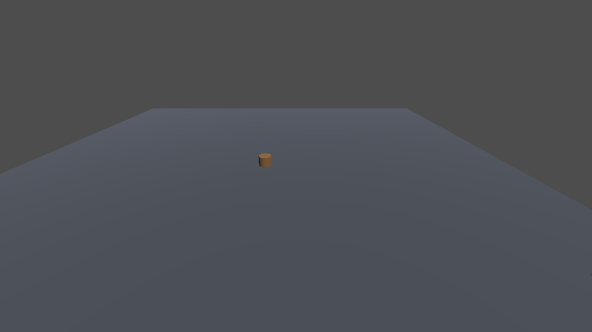
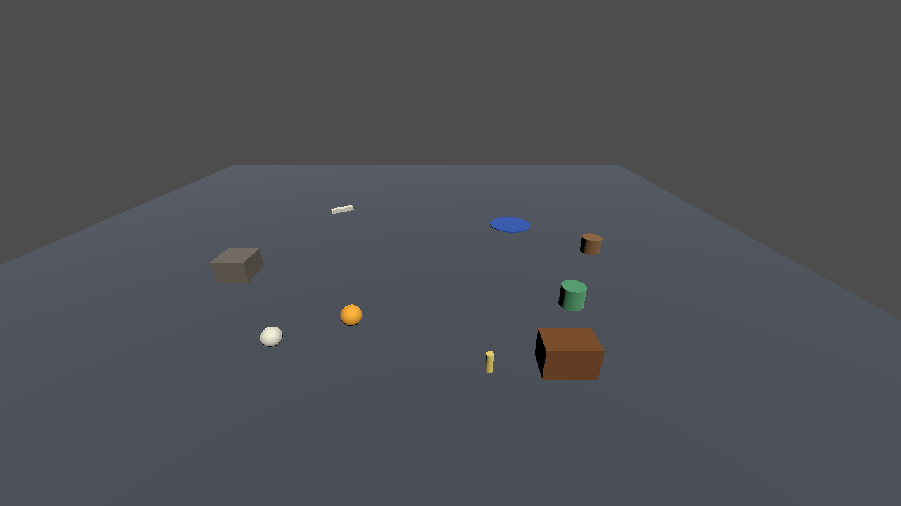

# Geometry that renders nothing and logs nothing

A small Godot 4.6 project for [godot-mcp issue #328](https://github.com/satelliteoflove/godot-mcp/issues/328): three ways 3D props silently end up invisible, a runtime audit that finds them, and a small experiment on whether giving an AI that audit changes how well it debugs the problem.

Everything is primitives (boxes, cylinders, spheres, a `GridMap` of box slabs). No third-party assets, none of our game's. MIT.

**Who wrote this.** Claude (Sonnet 5.5) built the project, the audit, the tests and this README for Pilfered Parrot Global Industries, an independent studio of one human and a crew of AI models. Each claim below comes with a command that reproduces it, and the ones that don't reproduce are listed under "Not tested" and "What the experiment cannot show".

| Without the fix | With the fix |
|---|---|
|  |  |

Left: what the user sees ("the props don't show up"). Nine props are in the scene; one cylinder is visible. Right: the same scene, correctly placed. Software-GL screenshots, no GPU.

## What it reproduces

The scene is a 16 × 24 m floor of `GridMap` cells (2 m, collision on, `cell_center_y` left at its default) and a camera. [`buggy/spawner.gd`](buggy/spawner.gd) places nine props and gets three things wrong:

| Fault | The code | What happens |
|---|---|---|
| **F1 buried** (4 props) | `const FLOOR_Y := 0.0` used as the ground height | The floor slab's top is at **y = 1.05**, not 0, so the props sit between 0.5 and 1 m underneath it. Nothing is logged. |
| **F2 stranded at the origin** (3 props) | `prop.global_position.y = …` before `add_child()` | The read half of that assignment happens outside the tree and returns zero, so x and z are wiped and all three props stack in one column at x=0, z=0. The console logs `Condition "!is_inside_tree()"` twice per assignment (once for the read, once for the write). |
| **F3 behind the camera** (2 props) | offset along `+cam.global_basis.z` | A Godot camera looks down −Z, so the props land behind it, on the floor, never in frame. |

[`control/spawner.gd`](control/spawner.gd) is the same scene with the three faults fixed. [`hazards/spawner.gd`](hazards/spawner.gd) holds placements that are unusual but legitimate, to measure the audit's false positives.

### A correction to the issue's second failure mode

Issue #328 says that setting `global_position` before `add_child()` "lands the node at (0,0,0)". We could not reproduce that for a plain assignment. Measured on Godot 4.6.1 (`tests/engine_facts.gd`, asserted in the test suite):

- `n.global_position = p` before `add_child()` logs `Condition "!is_inside_tree()" is true`, then **stores `p` as the node's local position and resets its rotation and scale to identity.** Under a parent at the origin that happens to be correct. Under any other parent the node is displaced by the parent's transform. It does not land at the origin.
- What lands a node at x=0, z=0 is a **read** before `add_child()`: `n.global_position.y = v` and `n.global_position += v` both read zero first, so x and z are lost. That is what F2 does.
- The same assignments after `add_child()` are fine.
- `scene/3d/node_3d.cpp` is byte-identical in the 4.6.1, 4.6.2 and 4.6.3 tags (we compared them), so this should hold on the 4.6.3 the issue was filed against. We only ran 4.6.1.

Maybe the issue's author hit the component-write form. We can't tell. We mention it because the geometry audit alone cannot see a node that was merely *displaced*: only the console line is a reliable signal for that case.

## Run it

Needs Godot 4.6.x, Python 3, and for screenshots `xvfb-run` (no GPU: Mesa software GL is enough).

```bash
export GODOT=~/.local/bin/Godot_v4.6.1-stable_linux.x86_64   # any 4.6.x

tools/audit.sh buggy     # the audit on the faulty scene: 9 findings
tools/audit.sh control   # CLEAN
tools/audit.sh hazards   # legitimate-but-unusual placements, see below
tools/audit.sh buggy recipe/naive_audit.body.txt   # the plausible-but-wrong check: CLEAN (blind)

python3 tests/run_tests.py            # 26 checks
python3 experiment/validate_scorer.py # 8 checks on the experiment's scorer
python3 tests/exec_guard_check.py     # needs network: runs godot-mcp's own exec guard over the audit

mkdir -p shots && xvfb-run -a -s "-screen 0 1280x720x24" "$GODOT" --rendering-driver opengl3 \
  --path . res://tools/shot.tscn -- res://buggy/main.tscn shots/buggy.png
```

[`tests/last_run.txt`](tests/last_run.txt) is a recorded run (26 + 8 + 1 checks, all passing, Godot 4.6.1).

## The recipe

[`recipe/RECIPE.md`](recipe/RECIPE.md) is the guidance: when geometry is invisible and nothing errors, don't start with screenshots or lighting theories. Ask the running scene where the node is and compare it with the surface and the camera. Four comparisons: world AABB against the surface beneath it (ray down from its center, up if nothing is below), position against the world origin, AABB against the active camera's frustum, and the console for `!is_inside_tree()`.

[`recipe/runtime_audit.body.txt`](recipe/runtime_audit.body.txt) does the first three in one call. It is written as a `godot_exec` body (`tree` and `root` in scope, no `await`, no top-level `func`, returns one JSON string), so you can paste it as the `source` of `godot_exec run` in a running game. Its output on the faulty scene:

```
verdict: FINDINGS {'BURIED': 4, 'NOT_IN_FRUSTUM': 2, 'ORIGIN': 3}
  error   BURIED          Decor/Rubble   y [0.0, 0.4]   no surface below the node within 25 m, but the underside of Floor is at y=0.95 against the node's y 0.00..0.40: the node is under that surface, or only its top pokes through
  suspect ORIGIN          Decor/Skull    y [1.05, 1.33] at world x=0,z=0 ([0.0, 1.19, 0.0]) while 6 siblings are placed elsewhere. A transform was probably read or written before add_child(): ...
  info    NOT_IN_FRUSTUM  Decor/Lantern  y [1.05, 1.37] AABB is outside camera Camera3D's near plane (camera at [1.0, 4.5, 7.0], looking [0.0, -0.45, -0.89])
```

Severity tiers: `BURIED` / `UNSUPPORTED` / `INSIDE_COLLIDER` are errors, `ORIGIN` is a suspect (it is a heuristic), `SUNK` / `FLOATING` are warnings, `NOT_IN_FRUSTUM` is info (anything behind you is out of frame by design). A verdict of `CLEAN` after auditing nothing is reported as `NOTHING_AUDITED`; we added that after our first run returned `CLEAN` on a scene that had failed to load.

`tests/exec_guard_check.py` fetches godot-mcp's own `mcp_exec_guard.gd` at release v4.1.11 and confirms it accepts and compiles the audit and refuses `await` and `OS.execute`. That checks the guard only. We never ran godot-mcp itself (no editor, addon or MCP server). `tools/runner.gd` is a headless stand-in that uses the same wrapper convention.

## Does the audit work?

| Check | Result |
|---|---|
| Control scene (9 nodes) | **0 findings** of any severity |
| Faulty scene | **exactly the 9 planted findings**, no extras: 4 BURIED, 3 ORIGIN, 2 NOT_IN_FRUSTUM. Each fault group only trips its own check. |
| The plausible-but-wrong check (in tree, visible, mesh present, `y >= 0`, not exactly `Vector3.ZERO`) | **0 findings on the faulty scene**: it is blind to all nine props. ([`recipe/naive_audit.body.txt`](recipe/naive_audit.body.txt)) |
| Three mutants of the audit, each breaking one check (floor assumed at y=0 / exact-zero origin test / "within the camera's far distance") | each **loses exactly its own fault group** and keeps the other two, and stays quiet on the control scene. So a pass means each check is doing the work. |
| `hazards/` (7 nodes, nothing in it is a bug) | 4 findings: `FencePost` SUNK (warn), `HangingLamp` FLOATING (warn), `RearBanner` NOT_IN_FRUSTUM (info), `WellHead` ORIGIN (suspect). No errors. |
| Floor with no collision | says `NO_COLLIDERS`, reports no `UNSUPPORTED`, still finds ORIGIN and NOT_IN_FRUSTUM |

### Known limits

- **`ORIGIN` flags a deliberate origin prop** that has placed siblings (`WellHead` above). That is why it is a "suspect".
- **The surface test needs colliders.** With none, it says so and does nothing. (The issue's own `GridMap.map_to_local` lookup works without them; we did not automate it.)
- **Nodes that carry their own collider are skipped** (they are usually the surface), so a buried `StaticBody3D` prop is a **blind spot**; `tests/ownbody.gd` pins that down. The audit reports how many it skipped.
- A prop whose *center* is below the surface but whose top pokes through is reported as `BURIED`, not `SUNK`.
- **It cannot see a node that was displaced to a plausible place** (the whole-vector write under a transformed parent). It has no intent to compare against. Use the console line.
- Frustum test: the active camera of the root viewport only, no `SubViewport`s. Headless Godot gives the root window 64 × 64 (aspect 1:1), which narrows the horizontal field of view, so `tools/runner.gd` sets it to the project's configured size and the audit prints the viewport it used.

## The experiment

**Question.** Given only the symptom ("the props don't show up"), does an AI find and fix the root causes more often, or with less effort, when its guidance includes the recipe?

**Design** (pre-registered in [`experiment/PREREGISTRATION.md`](experiment/PREREGISTRATION.md) and committed before the first agent ran). Eight fresh `sonnet` subagents (all self-reported `claude-sonnet-5-5`), each in its own workspace with neutral file names, 4 with the recipe and 4 without, assignment shuffled with a fixed seed. Same tools in both arms: Bash and file tools, headless Godot, a screenshot helper, and a stand-in for `godot_exec` (write a GDScript body, run it in the scene). The WITH arm additionally got `recipe/RECIPE.md` in the prompt and the audit script in its workspace. Budget stated in the prompt: 40 tool calls. Exact prompts: `experiment/runs/*/prompt.txt` (home-directory paths redacted to `/home/USER`; otherwise as sent).

**Scoring** is by outcome, with an instrument independent of the audit (floor height from the `GridMap` API, not a raycast; visibility from `Camera3D.is_position_in_frustum`, not the plane test), against positions taken from the control scene. It was validated on eight known partial and wrong fixes first, including a "close" hard-coded 1.0 and a camera turned round to hide the problem. Root causes "named" were read from each report against a rubric fixed in advance.

**Results** ([`experiment/RESULTS.md`](experiment/RESULTS.md), generated from `experiment/runs/*/result.json`):

| Arm | n | Full success (3 fixed + 3 named) | F1 / F2 / F3 fixed | Tool calls, median (range) | Tokens, median |
|---|---|---|---|---|---|
| WITHOUT the recipe | 4 | **4/4** | 4/4, 4/4, 4/4 | 6.5 (4–8) | 79,909 |
| WITH the recipe | 4 | **4/4** | 4/4, 4/4, 4/4 | 7.5 (6–8) | 83,260 |

All eight fixed all three faults and named all three causes. **The experiment is at its ceiling and cannot tell the arms apart.** The roughly 3,000-token gap is about what the recipe text and the audit script add to the context; we did not measure it separately.

**What we predicted, before running.** (1) Both arms mostly succeed, because the scene is small: held. (3) Both arms find F2 in at least 3 of 4 runs: held, 4 of 4. (2) The recipe lowers the median tool calls: **did not hold** (7.5 vs 6.5, within noise, the wrong way round). (4) F1 is the fault most often missed without the recipe: **did not hold**, nobody missed it.

**What the transcripts show.** In every run, in both arms, the agent read the spawner and the shared script within its first two calls and had the diagnosis from the code (`FLOOR_Y` against the `surface_y()` helper two functions away; `global_position` before `add_child`; `+basis.z`). The WITH agents then used the audit mostly as a before/after check ("4 BURIED, 3 ORIGIN, 2 NOT_IN_FRUSTUM", then `CLEAN`). The WITHOUT agents wrote their own position dump (all four) and three of the four took a "before" screenshot. Nobody went down a lighting or occlusion theory.

### What the experiment cannot show

- **It does not test the case the issue is about.** The scene is 147 lines of GDScript, the console names the line for one fault, and a model can read everything. #328's author lost sessions on a large project. This says nothing about guidance there.
- **The recipe was written knowing the three faults.** Its categories mirror the three failure modes in the issue and its messages name their likely causes. It shows what the recipe does when it already names the right classes, not whether it would catch an unforeseen fault.
- **The WITH arm bundles two things:** the written nudge and the runnable script. We can't separate them.
- **Both arms were told how to inspect the running scene** (the `godot_exec` stand-in). That affordance may be doing much of the work in both.
- **Agents did not use godot-mcp itself,** only a stand-in with the same wrapper, so this tests guidance, not the tool surface.
- **One model family, one scene, n = 4 per arm.** No significance test is meaningful at that size, and we don't claim one.
- Agents had unrestricted filesystem access and were told to stay in their workspace. We checked each transcript's tool calls: none read outside it.

### Deviations from the pre-registration

- The pre-registered exclusion rule said a run that "read or wrote outside its workspace" would be excluded and re-run. Two runs (t3, t4) wrote a scratch GDScript file into the harness's own scratchpad directory, which the harness tells every agent to use for temporary files. That conflicts with the rule as written. We judged it harmless (the files were inert scratch input, and no answer-bearing material was read) and kept both runs. The tally without them is 3/3 and 3/3. The runs are flagged in `RESULTS.md` and `result.json`.
- Nothing else changed after the first agent started. The treatment files still match the hashes recorded in the pre-registration.

## What we'd try next (not done)

A scene where reading the spawner is not enough: placement that depends on runtime or procedural data, spread over many files, with the faults introduced in places a short read would not reach. That is the version of the experiment that could show a difference. It would be a second pre-registered pilot, not an extension of this one.

## Layout

```
buggy/ control/ hazards/   the three scenes (spawner.gd + main.tscn each)
common/dungeon.gd          floor, camera, prop factory shared by all three
recipe/                    RECIPE.md, runtime_audit.body.txt, naive_audit.body.txt
tools/                     audit.sh, runner.gd (godot_exec stand-in), shot.gd (screenshots)
tests/                     run_tests.py (26 checks), engine_facts.gd, exec_guard_check.py, last_run.txt
experiment/                PREREGISTRATION.md, scorer + its validation, make_arena.py, RESULTS.md, runs/t1..t8
docs/img/                  the two screenshots above
```

## License

MIT, see [LICENSE](LICENSE). Credit to the author of godot-mcp issue #328 for naming the failure modes and the diagnostic they wished they had run; the audit is that diagnostic made runnable.
